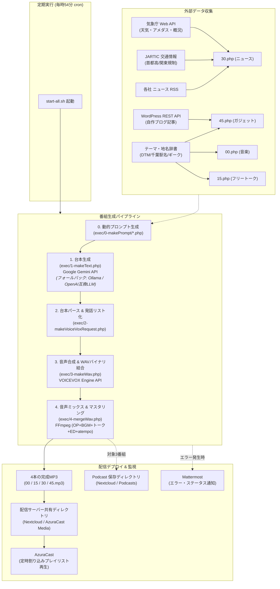

# 📻 ねるるラジオ (Neruru Radio)


> **Google Gemini × VOICEVOX × FFmpeg × AzuraCast**  
> AIによる24時間ラジオ番組制作・配信を全自動で実現する All-in-One 自動放送システム

[](#必要環境)
[](#主な機能)
[](#主な機能)
[](#主な機能)
[](#主な機能)
[](#ライセンス--利用規約)

---

## 🎙 実配信デモ (Live Demo)

本システムを用いて24時間365日フルオートメーションで制作・配信されているインターネットラジオです。

🔗 **[https://radio.enoki.xyz](https://radio.enoki.xyz)**

---

## 📖 概要

**ねるるラジオ**は、AIによる台本生成から音声合成、BGM・ジングルのミキシング、放送枠に合わせた自動尺調整（タイムストレッチ）、メタデータ埋め込み、配信用サーバーへのデプロイまでを**完全無人・全自動**で実行するラジオ番組自動制作システムです。

1時間ごとに「00分」「15分」「30分」「45分」の4つの異なる番組枠（各約10〜15分）を自動生成。気象庁のリアルタイム天気、JARTICのリアルタイム交通情報、最新ニュースRSS、オウンドメディアのブログ記事、そして数百を超える専門テーマ辞書を動的にプロンプトへ注入し、個性豊かなキャラクターたち（四国めたん、ずんだもん、春日部つむぎ、雨晴はう等）が軽快な掛け合いを繰り広げます。

---

## ✨ 主な特徴 (Features)

- 🤖 **Gemini によるマルチキャラクター掛け合い台本生成**
  - 四国めたん（MC/ナレーター）、ずんだもん（熱狂的オタク）、春日部つむぎ（聞き手/一般枠）、雨晴はう（交通・天気キャスター）などによる自然でユーモラスな掛け合い原稿を一度に数千〜1万字超で執筆。
- 🌐 **リアルタイム外部データ連携 (動的コンテキスト注入)**
  - **気象庁 API**: 東京・埼玉・千葉のアメダス観測データ（気温・降水量）、天気概況、翌日予報を自動取得。
  - **JARTIC 道路交通情報**: 首都高および関東圏の渋滞・通行止め・事故規制情報をリアルタイムパース（長期間継続工事の除外フィルタ付き）。
  - **ニュース RSS**: IT、自動車、バイク、地域、アニメ等の複数フィードからランダムに最新トピックを抽出。
  - **WordPress REST API**: 自身のブログ最新記事を取得し、番組内の特集コーナーで自動解説。
  - **巨大な専門知識辞書**: DTM/音楽機材、千葉県全域の鉄道駅・名所、自作PC/Linux/Tor/インフラなどの専門用語数千ワードをランダムピックアップ。
- 🛡️ **Gemini API キー自動ローテーション ＆ Ollama / OpenAI互換LLMフォールバック**
  - 無料枠の429エラー（レートリミット）検知時は設定された複数APIキーへ自動ローテーション。
  - 503エラー（高負荷）等でGeminiへの問い合わせが失敗した場合は、同一プロンプトを用いて**Ollama / OpenAI API互換の外部・ローカルLLM（Open WebUI等）へ自動フォールバック**し、台本生成処理を中断させずに継続。
- ⚡ **バイナリレベルでの高速 WAV 結合**
  - VOICEVOXで生成された数十〜数百行のセリフWAVを、外部ツールを使わずPHPで直接WAVヘッダー（44バイト）を解析・RIFFチャンクサイズを `pack('V')` で再計算し、瞬時に1本の長尺音声に結合。
- 🎚️ **FFmpeg によるプロ仕様のマスタリング & 放送尺自動補正**
  - **自動テンポ調整（`atempo`）**: トーク尺が枠の制限時間（11分/660秒）を超過した場合、ピッチ（音高）を維持したまま再生速度を自動倍速補正して指定枠内に確実に収束。
  - **ジングル & BGM ミックス**: オープニング／エンディングジングル、トーク裏のBGM自動ループ（`-stream_loop -1`）、トーク終了に合わせたフェード・ダッキング。
  - **ID3 タグ & カバーアート付与**: 番組タイトル・アーティスト名メタデータとジャケット画像（JPEG）をMP3内に埋め込み。
- 📡 **AzuraCast 連携 & 定時割り込み配信**
  - 生成されたMP3（`00.mp3`, `15.mp3`, `30.mp3`, `45.mp3`）を指定ディレクトリへ自動デプロイ。AzuraCastのスケジュール機能で定時割り込み放送。
- 🎧 **Podcast 自動アーカイブ ＆ RSS (XML) 自動生成**
  - 音声合成完了後、対象番組（「ねるるミュージックアカデミー」「サボさんの千葉来ません？」「ガジェットマニア」）の完成MP3をPodcast保存先（`musicacademy`, `sabochiba`, `gadgetmania` フォルダ）へ自動保存。
  - ファイル名は `番組名_YYYYMMDDHHMM.mp3` として保存し、各トピック一覧はMP3内部のID3タグ（`comment` / `description`）に完全収録。
  - さらに、保存完了時にApple Podcasts / Spotify規格準拠のRSSフィード（`musicacademy.xml`, `sabochiba.xml`, `gadgetmania.xml`）を `$RSS_PATH`（`https://radio.enoki.xyz/pages/rss/` 配下）へ自動生成・最新更新。エピソード説明文には「今日のトピック」詳細も自動反映。
- 🔔 **Mattermost Webhook によるリアルタイム死活監視**
  - APIエラーや音声生成の失敗、ファイルコピーの成否をMattermostへ即時通知。

---

## 🏗 システムアーキテクチャ (Architecture)



---

## 📻 タイムテーブル (Programs)

毎時1時間を4つのセグメントに分け、バラエティに富んだ番組を放送しています。

|    枠    | 番組名                                                                                                                | 出演キャラクター                         | 内容                                                                                                             |
| :------: | :-------------------------------------------------------------------------------------------------------------------- | :--------------------------------------- | :--------------------------------------------------------------------------------------------------------------- |
| **00分** | **ねるるミュージックアカデミー**<br>_(深夜は「ワールド・ナウ」)_                                                      | 四国めたん<br>春日部つむぎ<br>ずんだもん | DTM、シンセサイザー、VSTプラグイン、作曲技法、音作りなどの超ディープな音楽談義。深夜は世界の最新カルチャー特集。 |
| **15分** | **時間帯別フリートーク**<br>・朝: _オハラジオ_<br>・昼: _サボさんのチバ来ません？_<br>・夜/深夜: _ねるるの眠れない話_ | 四国めたん<br>春日部つむぎ               | 朝は元気な豆知識とお便りコーナー、昼は千葉県内全域の駅・名所散歩トーク、深夜は夜更かし雑談とお悩み相談。         |
| **30分** | **ネルラジニュース**                                                                                                  | 四国めたん<br>春日部つむぎ<br>雨晴はう   | 気象庁アメダス気温・天気概況、JARTIC首都高リアルタイム交通情報、厳選最新ニュースを報じる本格報道枠。             |
| **45分** | **ガジェットマニア**                                                                                                  | 四国めたん<br>春日部つむぎ<br>ずんだもん | 自作PC、逸般の誤家庭、Docker、Proxmox、Tor、秋葉原ジャンク、自作OSなどのハードコアなギークトーク＋ブログ解説。   |

---

## 📁 ディレクトリ構成 (Directory Structure)

```plaintext
gemini-api/
├── assets/                       # ジングル・BGM・画像リソース
│   ├── bgm/                      # 番組用BGM（時間帯別・番組別MP3）
│   ├── img/                      # ジャケット画像（ID3タグに埋め込むサムネイルJPG）
│   └── jingle/                   # オープニング・エンディング用ジングルMP3
├── buffer/                       # 一時生成テキスト（台本・発話リスト・ピックアップ情報）
├── exec/                         # 番組生成スクリプト本体
│   ├── 0-makePrompt/             # 動的プロンプト生成スクリプト
│   │   ├── 00.php                # 00分枠（音楽アカデミー）用プロンプト生成
│   │   ├── 15.php                # 15分枠（朝/昼/夜フリートーク）用プロンプト生成
│   │   ├── 30.php                # 30分枠（ニュース・交通・天気）用プロンプト生成
│   │   └── 45.php                # 45分枠（ガジェットマニア）用プロンプト生成
│   ├── func/
│   │   └── makeWavFunc.php       # VOICEVOX API (/audio_query, /synthesis) 呼び出し関数
│   ├── 1-makeText.php            # Step 1: Gemini API で原稿を生成（失敗時はOllama/OpenAI互換LLMへフォールバック）
│   ├── 2-makeVoiceVoxRequest.php # Step 2: 原稿をパースしてVOICEVOX用発話JSONに変換
│   ├── 3-makeWav.php             # Step 3: VOICEVOXで音声生成しWAVヘッダー結合
│   └── 4-mergeWav.php            # Step 4: FFmpegでOP/ED/BGM/トーク結合＆尺自動調整
├── logs/                         # 実行ログ
├── output/                       # 生成された音声ファイル
│   ├── buffer/                   # 各セリフの個別WAV
│   ├── 00.wav 〜 45.wav          # 結合済みトークWAV
│   └── final_podcast_00.mp3 〜   # ミックス・メタデータ付与完了済みの最終MP3
├── prompts/                      # プロンプトテンプレート集（txt）
│   ├── 00-ongaku.txt             # 音楽番組用プロンプト
│   ├── 00-world-shinya.txt       # 深夜ワールド番組用プロンプト
│   ├── 15-freetalk-asa.txt       # 朝ラジオ用プロンプト
│   ├── 15-freetalk-hiru.txt      # 昼千葉散歩用プロンプト
│   ├── 15-freetalk-shinya.txt    # 深夜ラジオ用プロンプト
│   ├── 30-news.txt               # ニュース用プロンプト
│   └── 45-gadget.txt             # ガジェット番組用プロンプト
├── talkHistory/                  # 生成された台本のアーカイブ保存先（YYYY-MM-DD-HHMM）
├── env.php                       # 環境設定ファイル（APIキー、URL等）※git管理外
├── env.php.sample                # 環境設定サンプルトークン
├── getJartic.php                 # JARTIC交通情報パース・JSON出力
├── getWeather.php                # 気象庁天気・アメダス情報取得・JSON出力
├── getWordPress.php              # WordPress REST APIからの記事取得・整形
├── request.php                   # Gemini API 呼び出しエンドポイント（プロキシラッパー）
├── sendMattermost.php            # Mattermost Webhook 通知スクリプト
├── start-all.sh                  # 定期実行用バッチスクリプト（全パイプライン実行・転送）
├── index.html                    # VOICEVOX 音声生成テスト用 WebUI
└── README.md                     # 本ドキュメント
```

---

## 🔧 必要環境 (Requirements)

- **OS**: Linux (Ubuntu 20.04/22.04 推奨) または WSL2 / macOS
- **PHP**: 8.1 以上
  - 必須拡張モジュール: `php-curl`, `php-xml` (simplexml), `php-json`, `php-mbstring`
- **Webサーバー**: Nginx または Apache（HTTP経由でローカル実行する場合）
- **VOICEVOX Engine**: ローカルまたはネットワーク上で稼働する VOICEVOX HTTP API サーバー（ポート `50021` 等）
- **FFmpeg / FFprobe**: 最新版推奨（`atempo`, `amix`, `concat`, `aresample` フィルタ対応）
- **Google Gemini API Key**: [Google AI Studio](https://aistudio.google.com/) にて取得（予備キー設定推奨）
- **Ollama / OpenAI互換LLMサーバー（任意）**: Gemini障害時のフォールバック先として利用する場合（Ollama、Open WebUI、vLLM、LM Studio等）
- **配信環境（任意）**: [AzuraCast](https://www.azuracast.com/)、Icecast、Nextcloud 等

---

## 🚀 インストール & セットアップ (Installation)

### 1. リポジトリのクローン

```bash
git clone https://github.com/your-username/neruru-radio.git
cd neruru-radio
```

### 2. 設定ファイルの作成

`env.php.sample` を `env.php` にコピーして編集します。

```bash
cp env.php.sample env.php
```

`env.php` 内の設定項目:

```php
<?php
// Gemini APIキー（複数指定で429/503時に自動ローテーション）
$API_KEYs = [
  'YOUR_GEMINI_API_KEY_1',
  'YOUR_GEMINI_API_KEY_2',
];

// 使用する Gemini モデル
$MODEL = 'gemini-3.1-flash-lite';

// VOICEVOX Engine の接続先
$VOICEVOX_HOST = 'http://localhost:50021';

// ニュース取得用 RSS フィード一覧
$RSS_URLs = [
  'https://rss.itmedia.co.jp/rss/2.0/news_bursts.xml',
  'https://news.yahoo.co.jp/rss/media/chibatele/all.xml',
  // お好みのRSSを追加
];

// Mattermost通知設定（任意）
$MATTERMOST_TOKEN = 'your_mattermost_token';
$INCOMING_WEBHOOK_URL = 'https://mattermost.example.com/hooks/xxxxxx';

// オウンドメディア / ブログ連携（任意）
$WORDPRESS_URL = 'https://your-blog.example.com';
$WORDPRESS_CATEGORY_ID = ['1', '2'];

// Ollama / OpenAI互換LLM設定（Gemini障害時のフォールバック先・任意）
$LLM_BASE_URL = 'https://ollama.example.com'; // 接続先URL
$LLM_API_KEY  = 'sk-XXXXXXXXXXXXXXXXXX';     // APIキー
$MODEL_NAME   = 'Gemma-4-26B-A4B';            // 使用モデル名
```

### 3. ディレクトリの権限設定

スクリプトが作業用ファイルや音声を出力できるように、書き込み権限を付与します。

```bash
chmod -R 777 buffer output talkHistory logs
```

### 4. アセット（音源・画像）の準備

`assets/` ディレクトリ内に必要なファイルが揃っていることを確認します。

- `assets/bgm/`: 各番組・時間帯用のBGM音源（MP3）
- `assets/jingle/`: 各番組のオープニング/エンディング用ジングル（MP3）
- `assets/img/`: 各番組用のカバーアート画像（JPG）

### 5. `start-all.sh` の環境設定

`start-all.sh` を開き、自身の環境に合わせてホスト名や転送先ディレクトリを修正します。

```bash
# 接続先WebサーバーのホストまたはIP
HOST="localhost"

# AzuraCast等の配信用メディアフォルダへのパス
DEST_DIR="/var/azuracast/stations/neruru_radio/media/podcasts/"
```

実行権限を付与します:

```bash
chmod +x start-all.sh
```

---

## 🏃 実行方法 (Usage)

### 手動実行でテスト

```bash
./start-all.sh
```

コンソールに各ステップ（台本生成 → 音声生成リクエスト → WAVヘッダー結合 → FFmpegミックス → 転送）のログが出力されます。

### cron による定期実行（完全自動化）

毎時 **54分** に実行するように crontab に登録します（次枠の00分放送開始に間に合うよう前もって生成）。

```bash
crontab -e
```

以下の行を追加:

```cron
54 * * * * cd /path/to/gemini-api && ./start-all.sh >> ./logs/cron.log 2>&1
```

### AzuraCast 側の割り込み設定

AzuraCast等の配信サーバー側で、以下の設定を行います:

1. スケジュールプレイリストを作成
2. 毎時 `00分`, `15分`, `30分`, `45分` に `00.mp3`, `15.mp3`, `30.mp3`, `45.mp3` を再生するように設定（再生中の曲に割り込み設定をON）

---

## 🛠 技術的なハイライト (Deep Dive)

### 1. WAV ヘッダーのバイナリ再構築（高速結合）

通常、多数のWAVファイルを結合するにはFFmpegのconcatプロトコルやSoXなどの外部ツールを介しますが、本システムではPHPのバイナリ操作関数（`pack`）を用いて直接WAVデータをストリーム連結します。
先頭ファイルの44バイトヘッダーを取得し、データ部分を追記した上で、ファイル全体サイズと音声データサイズ（RIFFチャンク）を書き換えることで、オーバーヘッドゼロの高速結合を実現しています。

```php
// 結合後データサイズからWAVヘッダーをリトルエンディアンで書き換え
$firstHeader = substr_replace($firstHeader, pack('V', $fileSize), 4, 4);
$firstHeader = substr_replace($firstHeader, pack('V', $dataSize), 40, 4);
file_put_contents($outputFilename, $firstHeader . $combinedData);
```

### 2. `atempo` フィルタによるインテリジェントな放送尺制御

AI生成の台本は回によってトークの長さが変動します。放送枠（15分枠）をはみ出さないよう、FFprobeでトーク音声の長さを事前に秒単位で計測。トークが11分（660秒）を超過している場合は、次のように目標尺に対する倍率を算出してFFmpegの `atempo` フィルターへ注入。ピッチ（声の高さ）を変えずに自動で早口再生化し、確実に枠内に収めます。

```php
$limitSeconds = 660.0;
if ($talkDuration > $limitSeconds) {
    $speedRatio = $talkDuration / $limitSeconds;
    $talkFilter .= sprintf(',atempo=%f', $speedRatio);
}
```

### 3. FFmpeg による 5 入力コンプレックスオーディオグラフ

単なる音声結合ではなく、プロのラジオ放送と同じ構成美を実現するためにFFmpegの複合フィルタ（`filter_complex`）を使用しています。

- 先頭と末尾に2秒間の完全な無音ソース（`anullsrc`）を自動生成してインサート
- トーク音量を適切にブースト（`volume=9.5`）しつつ 48kHz Stereo へリサンプリング
- BGMをループ再生（`-stream_loop -1`）し、トーク終了と同時にカット（`amix=duration=first`）
- カバーアート画像（`attached_pic`）およびID3v2メタデータを同時出力

### 4. Gemini 障害時の Ollama / OpenAI互換 LLM への自動フォールバック

定時放送システムでは、クラウドAIサービスのダウンや過負荷による台本生成の停止は放送事故（無音や再放送）に直結します。
本システムでは `/exec/1-makeText.php` において、Gemini APIへの問い合わせで 503 エラー（高負荷・一時障害）等を検知した際に、同一のプロンプトをそのまま引き継いでローカルや外部の Ollama / OpenAI API互換サーバー（Open WebUI等）へ自動フェイルオーバーする仕組みを実装しています。

- **同一プロンプトでの即時フォールバック**: Gemini用に動的生成された長文プロンプトをそのまま互換APIの `/api/chat/completions` 形式へマッピングしてリクエスト。
- **ストリーミングレスポンス（SSE）の解析**: `stream: true` で返却される Server-Sent Events のチャンクデータ（`data: {"choices":[{"delta":{"content":"..."}}]}`）を逐次パースして完全な台本テキストを復元。
- **Mattermost リアルタイム通知**: Geminiからの切り替え時や生成成功/失敗時にWebhookで通知を送信し、運用の可視性を確保。

```php
// exec/1-makeText.php: 503エラー検知時にOllama/OpenAI互換LLMへ同一プロンプトで切り替え
if ($errCode == 503) {
    echo "{$errCode}エラー（アクセス過多）のため、LLMでの生成に切り替えます\n";
    echo "次の{$min}分に放送する原稿作成は、GeminiがビジーなためLLMでの生成に切り替えます\n";
    return askLocalAI($prompt);
}
```

---

## 📜 ライセンス / クレジット (License & Credits)

### ソースコードライセンス

本プロジェクトのソースコードは [GPL License](LICENSE) のもとで公開されています。

### 音声ライブラリ規約

本システムは音声合成に [VOICEVOX](https://voicevox.hiroshiba.jp/) を使用しています。  
生成された音声を公開・配信する際は、各キャラクターの利用規約に従い適切なクレジット表記を行ってください。

- **VOICEVOX**: 四国めたん, ずんだもん, 春日部つむぎ, 波音リツ, 雨晴はう, 九州そら
- キャラクターの利用規約: [VOICEVOX利用規約](https://voicevox.hiroshiba.jp/)
